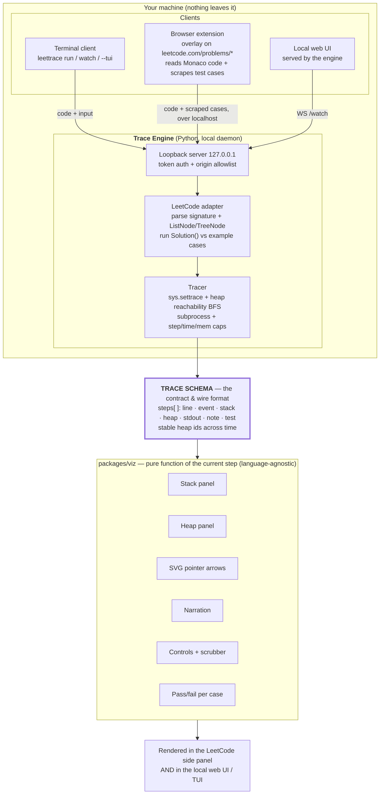

# Architecture

LeetTrace is a downloadable tool with **three surfaces that share one contract**. A local
**Trace Engine** runs your Python solution with a real CPython tracer and emits a **Trace**
(a language-agnostic schema). That same schema is the localhost wire format *and* the only
thing the visualization knows how to read. Your terminal and the LeetCode browser tab are
just two clients of the same engine.

### Reading the diagram
- **One engine, three clients.** The CLI, the extension, and the local web UI all send work
  to the same loopback daemon and all render the same `packages/viz`. The viz is built once.
- **Everything funnels through the Trace Schema**, which is simultaneously the engine's
  output, the localhost protocol, and the viz's only input. Nothing downstream of the engine
  contains the word "Python" — that's what makes adding JavaScript later a new *producer*,
  not a rewrite.
- **Nothing leaves the machine.** The server binds loopback only; the browser talks to it
  over `127.0.0.1` with a session token and a strict origin allowlist. There is no cloud.

### Why it's built this way
- **Real runtime, not a reimplementation.** The tracer instruments genuine CPython
  (`sys.settrace`) in an isolated subprocess, so the whole language is correct by
  construction and the live object graph is real — which is what makes linked lists and trees
  animate as true pointer graphs with stable identity across steps.
- **The browser can't (and shouldn't) trace.** The extension reads your code and the
  problem's example cases off the page and hands them to the local engine; execution happens
  on your machine, in your environment, like any debugger.
- **A localhost code-runner is a security surface.** Loopback-only binding + a per-session
  token + an origin allowlist + subprocess resource caps are load-bearing, not polish.
- **The view can't desync.** The UI renders purely from `steps[stepIndex]`, so step-back,
  scrubbing, and replay are exact.
