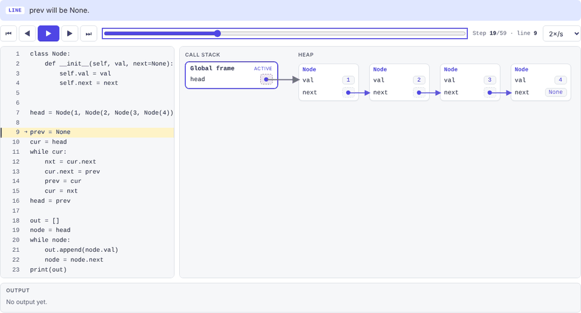
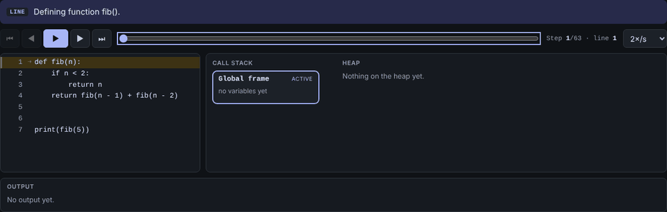
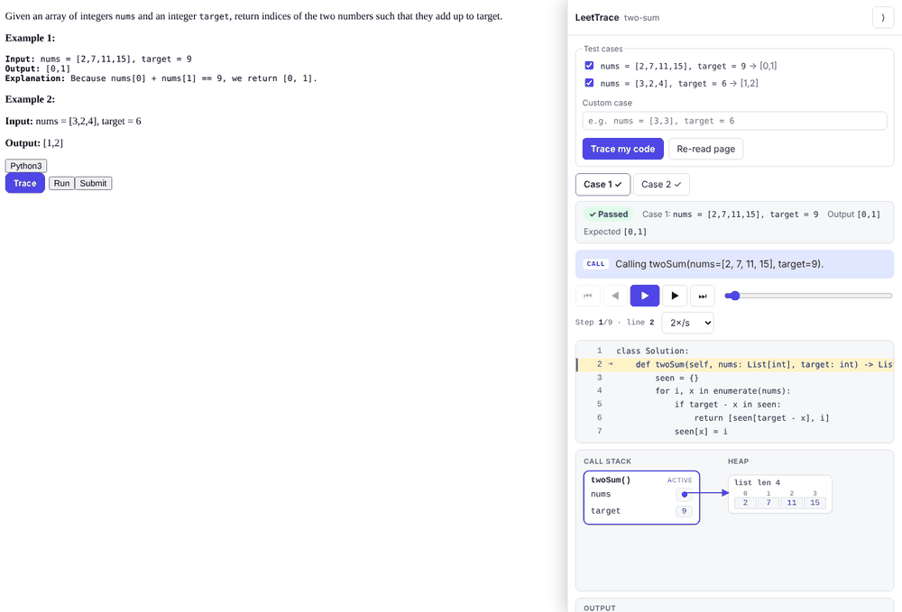
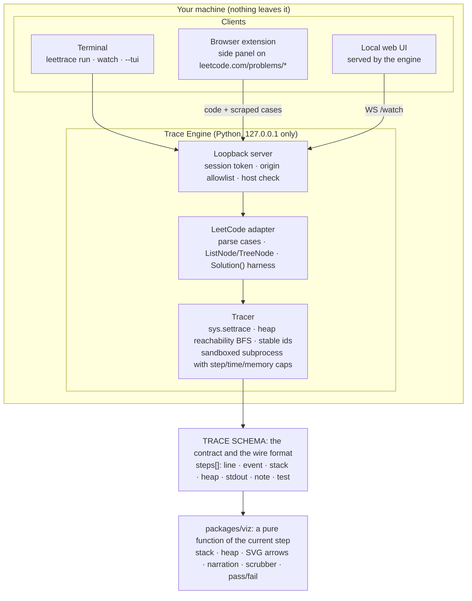

# LeetTrace

**See how your solution actually runs: the call stack, the heap, the pointer arrows, and a plain-English reason for every step. It works inside the LeetCode tab and in your terminal.**

LeetTrace is a developer tool you install, not a paste box. A small engine runs on your
machine and executes your Python with real CPython, instrumented by `sys.settrace`. It
rebuilds the live object graph at every step. You see the result in a side panel on
leetcode.com, in a local web UI, or in a terminal UI, all run against the problem's real
example cases.

<p align="center">
  
</p>

| Recursive Fibonacci                                                                                     | On the LeetCode tab                                                                                                               |
| ------------------------------------------------------------------------------------------------------- | --------------------------------------------------------------------------------------------------------------------------------- |
|  |  |

**Get it:** download the app for macOS, Windows or Linux from the
[LeetTrace site](https://leettrace.vercel.app) or the
[GitHub Releases](https://github.com/sunnyincalif-source/leettrace/releases/latest). Then add
the extension and pair; the app's welcome page walks you through it. Launching it yourself:
[LAUNCH_CHECKLIST.md](LAUNCH_CHECKLIST.md).

> LeetTrace is an independent, third-party tool. It is not affiliated with or endorsed by LeetCode.

---

## Contents

- [How it works](#how-it-works)
- [Install: from zero to a trace](#install-from-zero-to-a-trace)
- [Using it](#using-it)
- [The Trace contract](#the-trace-contract)
- [Security](#security)
- [Development](#development)
- [What's verified](#whats-verified)
- [Roadmap](#roadmap)

## How it works



**The engine owns execution, the schema is the contract, and every surface only renders.**

- **Real runtime, not a reimplementation.** The tracer drives genuine CPython. You get the
  whole language and correct semantics, and the engineering effort goes into reading state
  out well. Every `line`, `call`, `return`, and `exception` event captures the full stack and
  every object reachable from it, using a breadth-first search over the live object graph.
- **Stable identity.** Each object gets an id the first time it is seen, and that id holds
  for the whole trace. The heap layout is computed once per trace, so in a linked-list
  reversal the four nodes never move while their `next` arrows flip, one per step.
- **One visualization, three surfaces.** `packages/viz` is consumed by the web UI and by the
  extension's side panel. The terminal UI renders the same trace in Textual. None of them
  contains Python-specific code.
- **A reason per step.** The engine reads the AST node on the current line. It evaluates
  conditions with a small whitelisted evaluator that never calls user code, and looks ahead
  to the next snapshot. That produces notes like _"Checking if n <= 1 (5 <= 1) → False, so we
  skip the if block."_ A test checks every such claim against the state the viz actually
  shows.

The full design is in [SPEC.md](SPEC.md) and [ARCHITECTURE.md](ARCHITECTURE.md).

## Install: from zero to a trace

You need Python 3.11+ and Chrome or Firefox.

**1. Install the engine.**

```bash
pipx install leettrace            # once it's published on PyPI
# or, from this repo today:
pnpm install && pnpm --filter @leettrace/web build   # bundles the web UI into the engine
pipx install ./packages/engine
```

There is also a standalone binary that needs no Python. Build it with
`packages/engine/packaging/build_binary.sh`. The release workflow builds it for Linux,
macOS, and Windows.

**2. Start it.**

```bash
leettrace start
```

The engine listens on `127.0.0.1:47823`; if that port is taken, it tries the next ten. The
command prints a link to the local web UI.

**3. Add the extension.**

- **From a store listing:** once published, install it from there.
- **From this repo today:** run `pnpm --filter @leettrace/extension build`, open
  `chrome://extensions`, turn on **Developer mode**, click **Load unpacked**, and choose
  `apps/extension/dist`. For Firefox, load `apps/extension/dist-firefox` from
  `about:debugging`.

**4. Trace a problem.** Open any problem on leetcode.com, write Python 3, and click
**Trace** next to **Run**. The first time:

- Chrome may ask whether leetcode.com can reach apps on this device. Choose **Allow**. That is
  how the page reaches your local engine.
- The panel asks for a 6-digit pairing code. Copy it from the LeetTrace welcome page, which
  opens when you start the app (run `leettrace` with no arguments, or double-click it). The
  code is also printed in the terminal, and `leettrace pair` shows it again.

You can also skip the browser and run `leettrace demo` to see it work right away.

## Using it

```bash
leettrace run solution.py                 # trace a script once; opens the web UI
leettrace run solution.py --tui           # …or step through it in the terminal (←/→, Space, q)
leettrace watch solution.py               # re-trace on every save; the open UI live-updates
leettrace leetcode sol.py -c "nums = [2,7,11,15], target = 9" -e "[0,1]"   # class Solution + cases
leettrace demo                            # write two examples and trace one
leettrace status | open | pair | stop
```

LeetCode mode works with real LeetCode solutions:

- **What's already defined:** `ListNode`, `TreeNode`, `Optional`, `List`, `deque`, `heapq`,
  and the rest of LeetCode's implicit environment.
- **Inputs:** example inputs are parsed against the method signature, including
  `[3,9,20,null,null,15,7]` trees and lists of linked lists.
- **Checking answers:** for `-> None` problems the mutated first argument is compared.
  Outputs are compared structurally, with a tolerance for floats.
- **What you see:** only your own frames appear. Harness and prelude code is filtered out.

**Keys** (web and extension): ← / → to step, Space to play or pause, Home / End to jump. The
viz respects `prefers-reduced-motion` and supports light and dark themes.

## The Trace contract

Everything flows through one schema, defined in `packages/schema/src/index.ts` and mirrored
as Pydantic models in `packages/engine/src/leettrace/schema.py`. It is the engine's output,
the localhost wire format, and the only thing the visualization reads.

```ts
interface Trace {
  language: 'python'; // the union grows when a new tracer ships
  source: string;
  steps: Step[]; // every step is a complete snapshot: O(1) scrubbing
  test?: TestResult; // LeetCode mode: input, expected, actual, passed
  truncated?: boolean; // hit the step/time/memory cap
  error?: { type: string; message: string; line?: number };
  engineVersion: string; // clients refuse to misrender a mismatched engine
}
interface Step {
  i: number;
  line: number;
  event: 'line' | 'call' | 'return' | 'exception';
  stack: Frame[]; // top of stack last; locals are Values
  heap: Record<HeapId, HeapObject>; // only objects reachable from the stack
  stdout: string; // cumulative
  note?: string; // the "why"
}
type Value = Primitive | { kind: 'ref'; id: HeapId }; // ids are stable across steps
```

Adding a language means writing another _producer_ of this schema; the next planned one is
JavaScript via Node's inspector protocol. Nothing downstream changes. Both sides validate:

- The engine validates every trace with Pydantic before it leaves the sandbox.
- The clients validate with a zero-dependency type guard.
- A cross-language test checks that the engine's golden traces satisfy the TypeScript
  validator.

## Security

A localhost code runner is an attack surface, so the protections are part of the design:

- The server binds the loopback interface only.
- Every request needs a 256-bit session token.
- Only `https://leetcode.com` and the engine's own UI origin are accepted.
- The Host header is checked, to defeat DNS rebinding.
- The extension pairs once, using a one-time code from the local welcome page. The code
  rotates after repeated wrong guesses.
- Your code runs in a sandboxed subprocess with step, time, depth, memory, and CPU caps.

[docs/SECURITY.md](docs/SECURITY.md) has the full model, and each item is covered by tests.

## Development

```text
packages/schema     the Trace Schema (TS) + runtime validator
packages/engine     Python engine: tracer, narration, LeetCode adapter, server, CLI, TUI (uv)
packages/viz        shared React visualization + harness over recorded traces
apps/web            local web UI (served by the engine)
apps/extension      MV3 extension (CRXJS) — Chrome + Firefox builds
```

```bash
pnpm install && (cd packages/engine && uv sync)
pnpm build          # all workspaces (Turborepo); the web UI is copied into the engine
pnpm test           # Vitest + pytest
pnpm lint           # ESLint + Prettier + ruff + mypy --strict

pnpm --filter @leettrace/viz harness       # develop the viz against recorded traces
leettrace start --dev && pnpm --filter @leettrace/web dev   # UI dev server against the engine
pnpm --filter @leettrace/web e2e           # real engine + Chromium: watch-mode round trip
pnpm --filter @leettrace/web a11y          # axe-core WCAG 2.1 AA + 380px layout
pnpm --filter @leettrace/extension e2e     # unpacked extension + engine on a mock problem page
pnpm fixtures                               # refresh viz fixtures from the golden traces
```

Golden traces live in `packages/engine/tests/snapshots/`. A new snapshot fails the run so
that you review it. Existing ones change only with `uv run pytest --snapshot-update`, and the
diff should be reviewed before committing.

## What's verified

| Area               | How                                                                                                                                                                                                                                                                                                                                                     |
| ------------------ | ------------------------------------------------------------------------------------------------------------------------------------------------------------------------------------------------------------------------------------------------------------------------------------------------------------------------------------------------------- |
| Tracer correctness | Golden traces for factorial, recursive fib, linked-list build and reverse, BST insert + inorder, bubble sort, two-sum, divide-by-zero, and two LeetCode problems. Each checks real stdout, structural heap invariants (for example, after `reverse` the new head is the old tail's id and walking `next` gives `[4,3,2,1]`), and a full-trace snapshot. |
| Limits             | An infinite loop is truncated at the step cap, even one that swallows exceptions. Also tested: the wall-clock cap, the recursion cap, the memory cap, protocol-fd isolation, and exotic values that must never crash the tracer.                                                                                                                        |
| Narration          | Every "x will be V", "Calling f(n=…)", and condition note is checked against the next state the viz shows.                                                                                                                                                                                                                                              |
| Security           | 401 without a token, 403 for a foreign origin, 421 for a rebinding Host header, 413 for oversized bodies. Also tested: WebSocket auth, pairing brute-force lockout, a 0600 token file, and a test that fails the build if the source ever binds the wildcard address.                                                                                   |
| Viz                | The layout keeps nodes still across every step. Scrubbing and step-back produce identical DOM. Frames push and pop correctly, and exactly one pointer flips per reversal step.                                                                                                                                                                          |
| End to end         | Saving a watched file updates the open UI in about 200 ms. The extension e2e uses a mock problem page: daemon-off prompt, then pairing, then scraped examples, then Trace, then pass/fail with live arrows.                                                                                                                                             |
| Packaging          | The wheel was installed into a clean Python 3.11 venv, and the standalone binary was run in an empty environment.                                                                                                                                                                                                                                       |
| Quality            | Web UI: axe-core finds no WCAG 2.1 AA violations in light, dark, or 380 px layouts. Lighthouse scores Performance 91, Accessibility 99, Best Practices 100.                                                                                                                                                                                             |

## Roadmap

- **v1.5:** a JavaScript tracer via Node's inspector protocol (CDP), as a new producer of
  the same schema.
- **A richer "why":** an optional LLM narration tier, cached by source hash. It would always
  sit behind the rule-based notes and never become a runtime dependency.
- **Harder roadmap:** C++ via gdb/lldb MI and Java via JDWP/JDI. Each is real debugger
  integration and a project in its own right. v1 does not imply them.

## License

MIT
